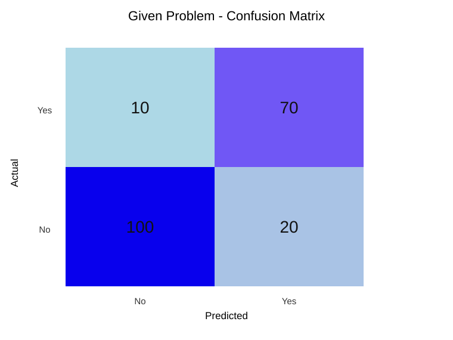
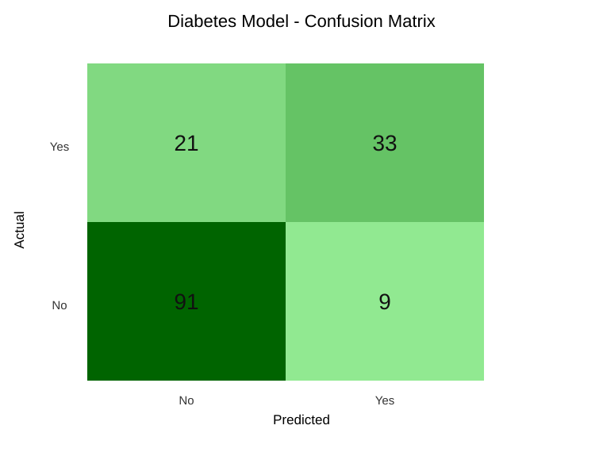
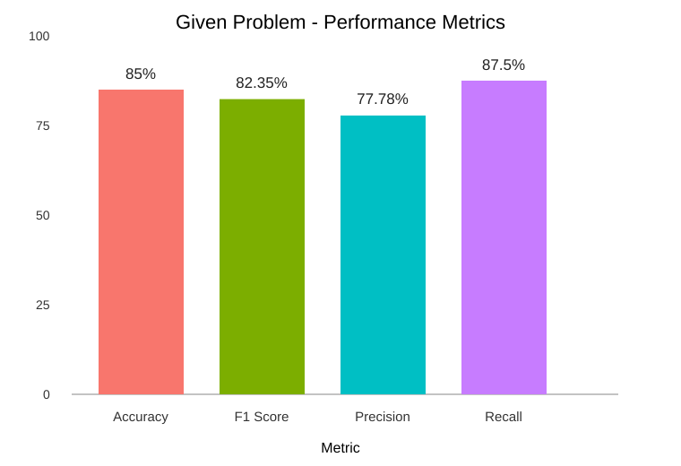
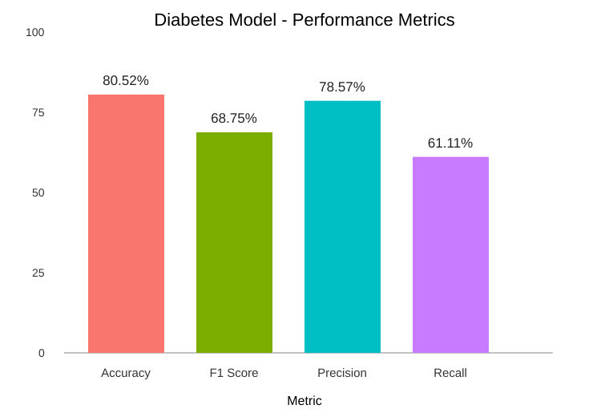

<div align="center">

# 🩺 Diabetes Prediction Using R

### A Machine Learning Project | Logistic Regression | Data Visualization

<p>
  
  
  
  
</p>

**Predicting diabetes outcomes through data analysis, statistical learning, and visual storytelling.**

[📓 Open Colab Notebook](Diabetes_Prediction_Using_R.ipynb) · [📊 View Outputs](outputs/) · [📈 View Visualizations](outputs/visualizations/)

</div>

---

## ✨ Project at a glance

This project uses the **Pima Indians Diabetes dataset** to build a supervised machine learning model that predicts whether a patient is likely to have diabetes based on selected diagnostic measurements.

The model is built in **R using Logistic Regression** through the `glm()` function with a binomial family. The workflow covers data inspection, preprocessing, model training, prediction, evaluation, and visualization.

| Project detail | Description |
|---|---|
| Programming language | R |
| Machine learning type | Supervised learning |
| Algorithm | Logistic Regression |
| Problem type | Binary classification |
| Dataset | Pima Indians Diabetes |
| Dataset size | 768 records × 9 columns |
| Training / testing | 614 / 154 records |
| Target variable | `Outcome` (0 = No, 1 = Yes) |

## 🎯 Objectives

- Explore and understand the diabetes dataset.
- Prepare the data for machine learning.
- Train a Logistic Regression classification model.
- Predict outcomes on unseen test records.
- Evaluate predictions using classification metrics and ROC-AUC.
- Present the results through clear, separate visualizations.

## 🧰 Tools and technologies

<p>
  
  
  
  
  
</p>

## 🧠 How the model works

```text
Pima Indians Diabetes Dataset
              │
              ▼
      Data inspection
              │
              ▼
       Data cleaning
  (selected zero values → NA,
       median imputation)
              │
              ▼
      Train / test split
        614 / 154 rows
              │
              ▼
       Logistic Regression
          (R: glm)
              │
              ▼
      Probability prediction
              │
              ▼
       Class prediction
        (threshold 0.5)
              │
              ▼
    Confusion matrix + metrics
        + ROC / AUC
              │
              ▼
       R visualizations
```

### Dataset features

The input variables are:

1. Pregnancies
2. Glucose
3. BloodPressure
4. SkinThickness
5. Insulin
6. BMI
7. DiabetesPedigreeFunction
8. Age

The target column is `Outcome`. In selected measurement columns, zero values are treated as missing and replaced with the column median, as implemented in the project code.

## 📊 Model performance

The following are the reported results from the model's test set:

| Evaluation metric | Result |
|---|---:|
| Accuracy | **80.52%** |
| Precision | **78.57%** |
| Recall | **61.11%** |
| F1-score | **68.75%** |
| ROC-AUC | **0.891** |

### Model confusion matrix

| Actual / Predicted | No | Yes |
|---|---:|---:|
| **No** | 91 | 9 |
| **Yes** | 21 | 33 |

### What do these metrics mean?

- **Accuracy:** Overall proportion of correct predictions.
- **Precision:** Of the patients predicted as diabetic, how many were actually diabetic.
- **Recall:** Of the patients who were actually diabetic, how many the model identified.
- **F1-score:** Harmonic mean of precision and recall.
- **ROC-AUC:** Measures how well the model distinguishes the two outcome classes across classification thresholds.

## 📝 Given problem vs. trained model

The project also includes a separate, supplied example problem with 200 patients. These values are **not** the Logistic Regression model's test-set results.

| Metric | Given problem | Trained model |
|---|---:|---:|
| Accuracy | 85.00% | 80.52% |
| Precision | 77.78% | 78.57% |
| Recall | 87.50% | 61.11% |
| F1-score | 82.35% | 68.75% |
| ROC-AUC | — | 0.891 |

**Given problem confusion matrix**

| Actual / Predicted | No | Yes |
|---|---:|---:|
| **No** | 100 | 20 |
| **Yes** | 10 | 70 |

Keeping these two result sets separate avoids confusing the example calculations with the model's measured test performance.

## 🖼️ Visualization gallery

The project notebook contains separate R plotting cells for the visual analysis. Preview files are also organized in the repository.

### Confusion matrices

| Given problem | Trained model |
|---|---|
|  |  |

### Performance metrics

| Given problem | Trained model |
|---|---|
|  |  |

### Dataset exploration and model evaluation

- [Diabetes outcome distribution](outputs/visualizations/diabetes_distribution.svg)
- [Glucose level distribution](outputs/visualizations/glucose_level_distribution.svg)
- [BMI vs. glucose](outputs/visualizations/bmi_vs_glucose.svg)
- [Age distribution](outputs/visualizations/age_distribution.svg)
- [Model metrics heatmap](outputs/visualizations/model_metrics_heatmap.svg)
- [ROC curve](outputs/visualizations/roc_curve.svg)

> For the complete data-driven plots and the original R plotting code, run the notebook from top to bottom. The SVG files in the output folder are visual previews based on the project results.

## 🚀 Run the project

### Option 1 — Google Colab (recommended)

1. Open [Diabetes_Prediction_Using_R.ipynb](Diabetes_Prediction_Using_R.ipynb).
2. Open the notebook in Google Colab.
3. Run the cells in order, from top to bottom.
4. Allow the setup cells to install R and the required packages.
5. Review the printed output and individual visualizations.

### Option 2 — RStudio

1. Clone or download this repository.
2. Open `diabetes_prediction.R` in RStudio.
3. Run the script.
4. Review the model output and generated files.

### Required R packages

- `ggplot2`
- `pROC`

The notebook/script includes package setup for the project workflow.

## 📁 Repository structure

```text
Diabetes-Prediction-Using-R/
│
├── Diabetes_Prediction_Using_R.ipynb
├── diabetes_prediction.R
├── README.md
├── .gitignore
│
├── outputs/
│   ├── README.md
│   ├── execution_output.txt
│   ├── given_problem_confusion_matrix.svg
│   ├── given_problem_performance_metrics.svg
│   ├── model_confusion_matrix.svg
│   ├── model_performance_metrics.svg
│   │
│   └── visualizations/
│       ├── diabetes_distribution.svg
│       ├── glucose_level_distribution.svg
│       ├── bmi_vs_glucose.svg
│       ├── age_distribution.svg
│       ├── model_metrics_heatmap.svg
│       └── roc_curve.svg
│
└── visualizations/
    └── README.md
```

## 📌 Key learning outcomes

- Working with a real-world-style healthcare dataset.
- Handling missing or invalid measurement values.
- Building a binary classification model in R.
- Understanding confusion matrices and evaluation metrics.
- Interpreting ROC curves and AUC scores.
- Creating individual plots with `ggplot2`.
- Documenting and publishing a machine learning project on GitHub.

## ⚠️ Disclaimer

This repository is for **educational purposes only**. It is not a medical device or diagnostic system. The model's predictions must not be used to diagnose diabetes, guide treatment, or replace advice from qualified healthcare professionals.

## 👨‍💻 Author

**Shashank K**  
B.Tech — Computer Science and Engineering

[](https://github.com/Shashank-Btech)

---

<div align="center">

### ⭐ If you find this project useful, consider giving the repository a star!

*Built with R • Machine Learning • Data Visualization*

</div>
